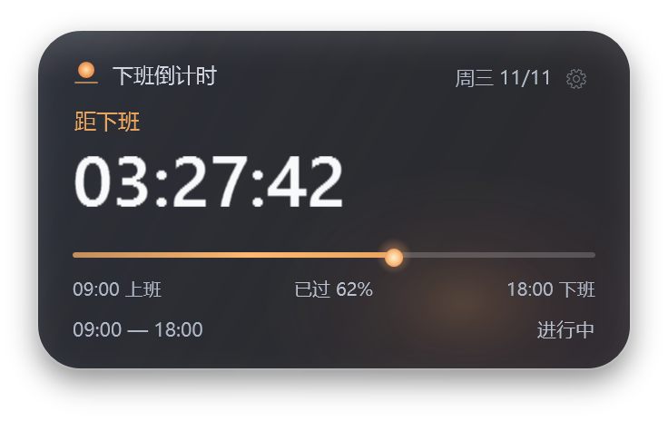

# 下班倒计时 · 桌面悬浮窗

一个给 Windows 桌面用的半透明下班倒计时。这个仓库是它的 **DSH 伴随插件**：安装后，DSH 启动时会拉起随包附带的 `OffWorkCountdown.exe`，小窗出现在桌面右下角，不占用 Harness 页面。



> Windows 10/11 x64 only. The bundle ships a prebuilt .NET Framework 4.8 desktop executable; the full source is in [`source.zip`](source.zip) and can be rebuilt with its `build.ps1`.

## 它做什么

- **距下班倒计时**：按上班 / 下班时间实时计算，显示 `HH:MM:SS`。
- **日落入海进度**：太阳从上班滑到下班，过了下班时间沉到线的尽头。
- **状态**：上班前 / 工作中 / 最后 10 分钟 / 已下班加班计时 / 周末休息。
- **半透明**：默认 88% 不透明度，设置里 65%–100% 可调；玻璃层和文字层分开。
- **桌面行为**：无边框、始终置顶、可拖动、贴边吸附、记住位置。
- **托盘与快捷键**：托盘菜单、隐藏/显示、置顶、鼠标穿透；`Ctrl+Alt+D` 开关穿透。
- **设置**：上下班时间、仅工作日、不透明度、置顶；`%APPDATA%\OffWorkCountdown\settings.json`。

## 安装

```bash
dsh plugin --profile desktop add github:suojianan/dsh-offwork-countdown
```

安装后 DSH 组合加载完成时，插件会启动桌面小窗。Windows 会把新进程当作普通桌面应用；如果没看到，检查右下角托盘里的日落图标。

卸载：

```bash
dsh plugin --profile desktop remove dsh-offwork-countdown
```

如果退出 DSH 后小窗还在，右键托盘图标退出即可；它也可以单独双击 `OffWorkCountdown.exe` 运行。

## 截图


## 结构

```
index.js               Host 半：启动/停止桌面小窗
cordis.patch.yml       插入 offwork-countdown-desktop 行
OffWorkCountdown.exe   预构建的 Windows 桌面小窗
working.png            主截图
states.png             五种状态
settings.png           设置面板
screenshots.json       市场截图清单
source.zip             完整 C# / WPF 源码、构建脚本、29 项时间测试
```

## 源码与构建

`source.zip` 是完整源码，没有 NuGet 依赖。解压后：

```powershell
Set-ExecutionPolicy -Scope Process Bypass
.\build.ps1
```

构建只使用 Windows 自带的 .NET Framework 4.8 `csc.exe`，生成新的 `OffWorkCountdown.exe`。测试：

```powershell
.\run-tests.ps1
```

## 说明与限制

- 仅支持 64 位 Windows 10/11；不支持跨午夜班次。
- 休息日按周六 / 周日判断，不识别法定节假日。
- 插件停止或禁用时，会结束它启动的小窗；如果小窗是先手动打开的，插件不会接管那个实例。
- 小窗是独立进程，所以它出现在所有桌面窗口之上，而不是 Harness 页面内部；这正是这个插件的用途。
- 预构建 exe 未做代码签名，Windows SmartScreen 可能提示；源码就在仓库里，可自行构建核对。

## License

MIT
